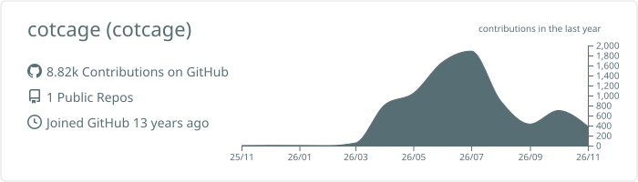

### Hi 👋

I love building things through terminal. I work at the [CMDM Lab](https://www.cmdm.tw).

#### 🔬 Research interests

- Metabolomics, lipidomics and breathomics
- Deep learning for mass spectrometry
- Biomedical databases and knowledgebases
- AI agents in biomedical & environmental science

#### 📄 Selected publications

- **DeePFAS: Deep-Learning-Enabled Rapid Annotation of PFAS: Enhancing Nontargeted Screening through Spectral Encoding and Latent Space Analysis.** *Environmental Science & Technology*, 2025. [paper](https://doi.org/10.1021/acs.est.5c09769) · [code](https://github.com/CMDM-Lab/DeePFAS)
- **Identifying novel metabolites in children with attention-deficit hyperactivity disorder through metabolome profiling.** *Translational Psychiatry*, 2025. [paper](https://doi.org/10.1038/s41398-025-03393-5)
- **A Clinical Breathomics Dataset.** *Scientific Data*, 2024. [paper](https://doi.org/10.1038/s41597-024-03052-2)
- **Human Breathomics Database.** *Database*, 2020. [paper](https://doi.org/10.1093/database/baz139)
- **LipidPedia: a comprehensive lipid knowledgebase.** *Bioinformatics*, 2018. [paper](https://doi.org/10.1093/bioinformatics/bty213)

Full list on [Google Scholar](https://scholar.google.com/citations?user=aLiPJ6AAAAAJ&hl=zh-TW).

#### 🛠️ Selected projects

| Project | Description |
|---|---|
| [MSIr](https://github.com/CMDM-Lab/MSIr) | Automatic registration service for mass spectrometry imaging and histology ([paper](https://doi.org/10.1021/acs.analchem.2c04360)) |
| [MetaboSquad](https://github.com/CMDM-Lab/MetaboSquad) | A multi-agent intelligent assistant for metabolomics |

#### 🧰 Tech stack

#### 📈 Activity

